## 👋 Olá, meu nome é Guilherme


Sou **estudante de Análise e Desenvolvimento de Sistemas** e estou em busca da minha **primeira oportunidade em Help Desk / Suporte N1**, com muita vontade de crescer até o N2.

Gosto de entender o problema de verdade, explicar a solução sem jargão e aprender com cada chamado. Para não esperar a oportunidade chegar, **construí do zero o meu próprio sistema de chamados, o NEXUS**.

- 🎯 **Objetivo:** vaga de Help Desk / Suporte N1 (e evoluir para N2)
- 🛠️ **Projeto principal:** NEXUS HelpDesk, no ar e com código aberto
- 🔁 **Rotina:** estudar, construir e documentar

<div align="center">



<br>

[](https://www.linkedin.com/in/guilherme-medeiros-oliveira-478b45291)
[](mailto:medeiros.oliveira.guilherme@gmail.com)
[](https://helpdesk-nexus-lac.vercel.app)

</div>

---

## 🚀 Projeto em destaque: NEXUS HelpDesk System

<div align="center">

<a href="https://helpdesk-nexus-lac.vercel.app"></a>

**“Ponto de conexão entre o problema e a solução.”**

[](https://github.com/guilherme-medeiros-oliveira/helpdesk-nexus/commits/main)
[](https://github.com/guilherme-medeiros-oliveira/helpdesk-nexus/commits/main)
[](https://github.com/guilherme-medeiros-oliveira/helpdesk-nexus)

</div>

> O NEXUS **substitui planilha e WhatsApp**: o cliente abre o chamado, o técnico responde e atualiza o status, e tudo fica registrado com protocolo e histórico.

### 🔄 O caminho de um chamado

```mermaid
sequenceDiagram
    autonumber
    actor Cliente as Cliente
    participant NEXUS as NEXUS
    actor Tecnico as Tecnico
    Cliente->>NEXUS: Abre o chamado
    NEXUS-->>Cliente: Protocolo NX-000001
    Tecnico->>NEXUS: Muda status para Em Andamento
    Cliente->>NEXUS: Mensagem no chat
    Tecnico->>NEXUS: Responde e fecha
### ✨ O que o sistema faz
Recurso	Como funciona
**Protocolo automático**	`NX-000001`, `NX-000002`…
**Categorias e prioridade**	Suporte Técnico, Rede, Software, Hardware, E-mail e Impressora
**Status**	Aberto → Em Andamento → Fechado
**Chat**	Conversa estilo WhatsApp com histórico
**Painéis**	Cliente vê só os dele, admin vê tudo
**SLA**	4h úteis
**Segurança**	password_hash, prepared statements, XSS, httponly
**LGPD**	Termos e Política com aceite
**Fuso**	America/Sao_Paulo
### 📸 Telas

<table>
<tr>
<td align="center" width="50%">
<a href="https://helpdesk-nexus-lac.vercel.app"></a>
<br><sub><b>Painel do cliente</b></sub>
</td>
<td align="center" width="50%">
<a href="https://helpdesk-nexus-lac.vercel.app"></a>
<br><sub><b>Painel admin</b></sub>
</td>
</tr>
</table>

### 🧪 Teste em 1 minuto

1. Abra o https://helpdesk-nexus-lac.vercel.app
2. Crie uma conta e abra um chamado
3. Entre como admin e responda

### 🗺️ Próximos passos
Módulo	Situação
**NEXUS HelpDesk**	✅ No ar
**NEXUS Inventory**	🗓️ Planejado
**NEXUS KB**	🗓️ Planejado
**NEXUS Check**	🗓️ Planejado
---

## 🎧 Como eu atendo
1️⃣ Escutar	2️⃣ Diagnosticar	3️⃣ Resolver	4️⃣ Documentar
Entendo com calma	Isolo a causa	Aplico a solução	Registro tudo
## 🌱 Em estudo

`Windows 10/11` · `Active Directory` · `Redes` · `Linux` · `Hardware` · `Microsoft 365` · `ITIL`

## 💻 Tecnologias

!https://img.shields.io/badge/PHP-8.2-777BB4?style=flat-square&logo=php&logoColor=white
!https://img.shields.io/badge/MySQL-8-4479A1?style=flat-square&logo=mysql&logoColor=white
!https://img.shields.io/badge/HTML5-E34F26?style=flat-square&logo=html5&logoColor=white
!https://img.shields.io/badge/CSS3-1572B6?style=flat-square&logo=css3&logoColor=white
!https://img.shields.io/badge/JavaScript-F7DF1E?style=flat-square&logo=javascript&logoColor=black
!https://img.shields.io/badge/Git-F05032?style=flat-square&logo=git&logoColor=white

## 📫 Vamos conversar?

<div align="center">

https://img.shields.io/badge/LinkedIn-Conectar-0A66C2?style=for-the-badge&logo=linkedin&logoColor=white](https://www.linkedin.com/in/guilherme-medeiros-oliveira-478b45291)
https://img.shields.io/badge/E--mail-Falar_comigo-EA4335?style=for-the-badge&logo=gmail&logoColor=white](mailto:medeiros.oliveira.guilherme@gmail.com)

*NEXUS HelpDesk* · _Ponto de conexão entre o problema e a solução_

</div>
