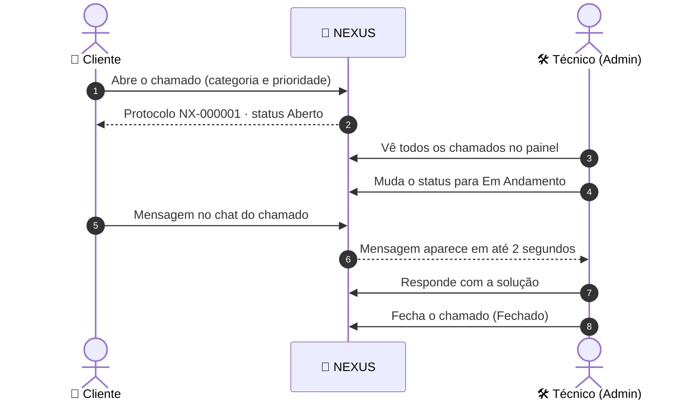

<!--
  README do perfil (repositório guilherme-medeiros-oliveira/guilherme-medeiros-oliveira).
  Suba na raiz do repositório: README.md, banner.svg e guilherme-medeiros.png.
-->

 

<!--
  Quando seu portfólio estiver online, remova as marcas de comentário desta linha e troque a URL:
  
-->

---

## 👋 Olá, meu nome é Guilherme

Sou **estudante de Análise e Desenvolvimento de Sistemas** e estou em busca da minha **primeira oportunidade em Help Desk / Suporte N1**, com muita vontade de crescer até o N2.

Gosto de entender o problema de verdade, explicar a solução sem jargão e aprender com cada chamado. Para não esperar a oportunidade chegar, **construí do zero o meu próprio sistema de chamados, o NEXUS**: foi a forma que encontrei de aprender o atendimento por dentro, do protocolo ao chat, do cliente ao técnico.

- 🎯 **Objetivo:** vaga de Help Desk / Suporte N1 (e evoluir para N2)
- 🛠️ **Projeto principal:** NEXUS HelpDesk, no ar e com código aberto
- 🔁 **Rotina:** estudar, construir e documentar (mais de 100 commits só no NEXUS)

---

## 🚀 Projeto em destaque: NEXUS HelpDesk System

**“Ponto de conexão entre o problema e a solução.”**

> O NEXUS **substitui planilha e WhatsApp**: o cliente abre o chamado, o técnico responde e atualiza o status, e tudo fica registrado com protocolo e histórico.
>
> 💡 *NEXUS vem do latim: o ponto central onde tudo se conecta. Aqui, é o elo entre o problema do usuário e a solução técnica.*

### 🔄 O caminho de um chamado

### ✨ O que o sistema faz

| | Recurso | Como funciona |
|:-:|---|---|
| 🎫 | **Protocolo automático** | Cada chamado ganha um número único: `NX-000001`, `NX-000002`… |
| 🗂️ | **Categorias e prioridade** | Suporte Técnico, Rede, Software, Hardware, E-mail e Impressora · 🟢 Baixa 🟡 Média 🔴 Alta |
| 🔄 | **Status do chamado** | Aberto → Em Andamento → Fechado, atualizado pelo técnico |
| 💬 | **Chat dentro do chamado** | Conversa estilo WhatsApp, com histórico salvo e atualização a cada 2 segundos |
| 👥 | **Painéis por perfil** | O cliente vê só os próprios chamados; o admin vê tudo, responde, muda o status e exclui (com confirmação) |
| ⏱️ | **SLA de 4h úteis** | Prazo de atendimento informado ao cliente no sistema |
| 🔐 | **Segurança** | Senhas com `password_hash`, *prepared statements*, saída escapada contra XSS e cookies de sessão `httponly` e `secure` |
| ⚖️ | **LGPD** | Termos de Uso e Política de Privacidade, com aceite antes do login |
| 🕐 | **Horário de Brasília** | Fuso `America/Sao_Paulo` em todo o sistema |
| 📱 | **Responsivo** | Layout adaptável (Flex e Grid) para celular e desktop |

### 📸 Telas

<table>
<tr>
<td align="center" width="50%">

 <b>Painel do cliente</b> · conversa estilo WhatsApp
</td>
<td align="center" width="50%">

 <b>Painel admin</b> · edição e exclusão do chamado
</td>
</tr>
</table>

### 🧪 Teste em 1 minuto

1. Abra o [NEXUS ao vivo](https://helpdesk-nexus-lac.vercel.app) e crie uma conta (ou use as [contas de teste](https://github.com/guilherme-medeiros-oliveira/helpdesk-nexus#-acesso-de-teste) do projeto).
2. Abra um chamado escolhendo categoria e prioridade.
3. Entre como admin, responda no chat e mude o status.
4. Volte como cliente e veja a resposta chegar.

### 🗺️ Próximos passos: o ecossistema NEXUS

| Módulo | Código | O que vai fazer | Situação |
|---|---|---|---|
| **NEXUS HelpDesk** | `NX-000001` | Gestão de chamados com chat, status e SLA | ✅ No ar |
| **NEXUS Inventory** | `AST-0001` | Controle de ativos com QR Code, nº de série, nota fiscal, usuário responsável e alerta de licença | 🗓️ Planejado |
| **NEXUS KB** | `KB-0001` | Base de conhecimento com busca e avaliação 👍/👎 (editor TinyMCE) | 🗓️ Planejado |
| **NEXUS Check** | — | Monitor de uptime estilo página de status, verificando a cada 5 minutos (cURL + Cron) | 🗓️ Planejado |

---

## 🎧 Como eu atendo um chamado

| 1️⃣ Escutar | 2️⃣ Diagnosticar | 3️⃣ Resolver | 4️⃣ Documentar |
|:---:|:---:|:---:|:---:|
| Entendo o problema com calma e empatia, sem jargão | Faço as perguntas certas e isolo a causa | Aplico a solução, confirmo com o usuário e escalo quando preciso | Registro tudo para o próximo chamado ser mais rápido |

## 🌱 Em estudo e prática

<!-- Ajuste esta lista para refletir exatamente o que você estuda e já sabe fazer. -->
`Windows 10/11` · `Active Directory` · `Redes (TCP/IP, DNS, DHCP)` · `Linux básico` · `Hardware` · `Microsoft 365` · `Acesso remoto` · `Fundamentos de ITIL`

## 💻 Tecnologias

<b>📈 Estatísticas do GitHub</b>

 

---

## 📫 Vamos conversar?

Estou pronto para começar e aprender rápido. Se você tem uma vaga de **Help Desk / Suporte N1**, ou só quer trocar uma ideia sobre o NEXUS, me chame:

 

**NEXUS HelpDesk** · *Ponto de conexão entre o problema e a solução* 🎧

Gostou do projeto? Deixe uma ⭐ no [repositório do NEXUS](https://github.com/guilherme-medeiros-oliveira/helpdesk-nexus)!

